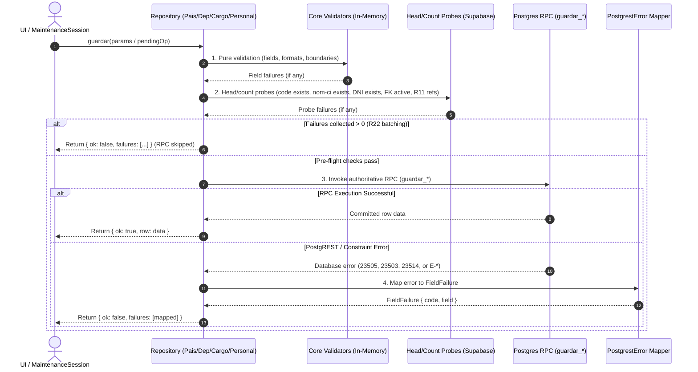

# Maestro de Personal — Internal Architecture & Developer Guide

This document captures the internal architecture, integration contracts, validation pipelines, environment setup, and test verification evidence for the **Maestro de Personal** application.

---

## 1. Architecture Map (`core/` ↔ `data/`)

The application architecture strictly separates domain logic from data access and transport concerns:

```
┌────────────────────────────────────────────────────────────────────────┐
│                        Surfaces / UI Layer (Ionic / React)             │
└───────────────────────────────────┬────────────────────────────────────┘
                                    │ imports via barrels
         ┌──────────────────────────┴──────────────────────────┐
         ▼                                                     ▼
┌───────────────────────────────┐             ┌───────────────────────────────┐
│     core/ (Domain Logic)      │             │      data/ (Data & RPC)       │
│                               │             │                               │
│  - constants.ts               │◄────────────│  - client.ts (Supabase)       │
│  - errors.ts                  │             │  - paging.ts (Pagination)     │
│  - types.ts                   │             │  - query.ts (PostgREST query) │
│  - validators.ts (Pure)       │             │  - repositories.ts (Repos)    │
│  - lifecycle.ts (State Mach.) │             │                               │
│  - session.ts (Op Session)    │             │                               │
│                               │             │                               │
│  Barrel: core/index.ts        │             │  Barrel: data/index.ts        │
└───────────────────────────────┘             └───────────────┬───────────────┘
                                                              │
                                                              ▼
                                              ┌───────────────────────────────┐
                                              │       Supabase Postgres       │
                                              │   (Tables, RPCs, Triggers)    │
                                              └───────────────────────────────┘
```

### 1.1 `app/src/core/` (Pure Domain Model)

- **Zero I/O, framework-agnostic**: No browser, DOM, or backend dependencies.
- **`constants.ts`**: Single source of truth for constraints (`DNI_LEN = 8`, `MIN_NAME = 2`, `MAX_NAME = 100`, `MIN_AGE = 18`), states (`EST_A = 1`, `EST_I = 2`, `EST_X = 3`, symbols `'A'`, `'I'`, `'*'`), code bounds (`MIN_CODE = 1`, `MAX_SMALLINT = 32767`, `MAX_INTEGER = 2147483647`), and canonical table names.
- **`errors.ts`**: 9 normative error codes (`E-PENDING`, `E-REQUIRED`, `E-FORMAT`, `E-RANGE`, `E-DUP`, `E-REF`, `E-REF-STATE`, `E-REF-BLOCKED`, `E-TRANSITION`) and `FieldFailure` shape `{ code, field }`. Pure errors report only machine-readable codes and fields; no human presentation copy.
- **`types.ts`**: Branded numeric code identifiers (`PaiCod`, `DepCod`, `CarCod`, `PerCod`), table row contracts (`PaisRow`, `DependenciaRow`, `CargoRow`, `PersonalRow`, `EstRegRow`), input payloads, discriminated union `PendingOp` (`adición`, `modificación`, `eliminación`, `inactivar`, `reactivar`), and `GuardarResult`.
- **`validators.ts`**: Pure validation functions (`validateCode`, `validateNom`, `validateDNI`, `validateFecNac`, `validatePaisRow`, `validateDependenciaRow`, `validateCargoRow`, `validatePersonalRow`, `validateRow`). Dates are evaluated against an injected `todayLocal` parameter (no hidden `Date.now()` calls).
- **`lifecycle.ts`**: Record lifecycle state machine. Encodes §6.1 transition table matrix, checking operation validity (`canTransition`), computing next states (`getNextState`), and enforcing Adición forced state (`EST_A`).
- **`session.ts`**: `MaintenanceSession` pure state machine tracking at most one pending operation per maintenance session (§8). Manages `start()`, `updatePayload()`, `cancel()`, `guardar()`, and `salir()`.
- **Public barrel**: `app/src/core/index.ts`.

### 1.2 `app/src/data/` (Supabase Data & RPC Layer)

- **`client.ts`**: Singleton initialization of `@supabase/supabase-js` reading `VITE_SUPABASE_URL` and `VITE_SUPABASE_PUBLISHABLE_KEY`. Provides `getSupabaseClient()` and `supabase` proxy.
- **`paging.ts`**: Server-side pagination defaults (`DEFAULT_PAGE_LIMIT = 50`), boundary validators, and query range appliers (`applyRange`, `applyPaging`).
- **`query.ts`**: Query builder generators for PostgREST returning unexecuted builders attached with typed query descriptors:
  - `listQuery()`: Paged list queries with explicit `ORDER BY` (R18).
  - `simpleSearch()`: Case-insensitive contains search across name, DNI, and numeric code.
  - `advancedSearch()`: Multi-field AND-combined filters with range queries on birthdates.
  - `gsel()`: Generic reference selection (G-SEL; SPEC §9) returning Activo-only rows ordered alphabetically with code tiebreak.
- **`repositories.ts`**: Concrete entity repositories (`PaisRepo`, `DependenciaRepo`, `CargoRepo`, `PersonalRepo`) extending `BaseRepo` and `ReferenceRepo`. Performs client-side pre-flight validations, head/count probes (uniqueness, FK valid state, R11 live-reference delete protection), and executes atomic DB RPCs (`guardar_pais`, `guardar_dependencia`, `guardar_cargo`, `guardar_personal`).
- **Public barrel**: `app/src/data/index.ts`.

---

## 2. Environment Setup

The application reads credentials from root `.env` or `app/.env`:

```env
# Required for App runtime (Vite / Browser)
VITE_SUPABASE_URL="https://<project-id>.supabase.co"
VITE_SUPABASE_PUBLISHABLE_KEY="<publishable-or-anon-key>"

# Required for Live DB Integration Tests (vitest)
SUPABASE_URL="https://<project-id>.supabase.co"
PUBLISHABLE_KEY="<publishable-or-anon-key>"
SECRET_KEY="<secret-or-service-role-key>"
LIVE_DB=1
```

- When running Vite or browser builds, `import.meta.env.VITE_SUPABASE_URL` and `import.meta.env.VITE_SUPABASE_PUBLISHABLE_KEY` are consumed.
- When running Node / Vitest tests, `getSupabaseClient()` dynamically inspects `process.env` and parses the `.env` file from the parent directory if unset.

---

## 3. Guardar Flow Diagram (pre-validate → RPC → map)

The `guardar()` method in repositories guarantees zero invalid database round-trips and complete failure batching (SPEC R22):



---

## 4. Paging Defaults

Pagination adheres to SPEC §11 Decision:

- **Default Page Size (`DEFAULT_PAGE_LIMIT`)**: `50` rows.
- **Range Mechanism**: PostgREST 0-indexed inclusive bounds:
  $$\text{from} = \text{offset},\quad \text{to} = \text{offset} + \text{limit} - 1$$
- **Query Bounds Validation**:
  - `offset`: Safe integer $\ge 0$.
  - `limit`: Safe integer $> 0$.
- **Ordering Enforcement (R18)**: Every list and search query applies an explicit, deterministic `ORDER BY` clause to prevent unstable paging windows across queries.

---

## 5. Normative Error Code Table

| Error Code      | Semantic Description              | Normative Trigger / Scope                                                                             | Offending Field Example                     |
| --------------- | --------------------------------- | ----------------------------------------------------------------------------------------------------- | ------------------------------------------- |
| `E-PENDING`     | Maintenance session collision     | Attempting `start()` or `salir()` while another operation is uncommitted (§8.1, §8.7)                 | `'session'`                                 |
| `E-REQUIRED`    | Mandatory field missing           | Field omitted, `null`, `undefined`, or whitespace-only                                                | `'PaiNom'`, `'PerDNI'`, `'PerCod'`          |
| `E-FORMAT`      | Value syntax invalid              | DNI not 8 digits; non-integer codes; non-canonical date formats                                       | `'PerDNI'`, `'PerFecNac'`, `'PaiCod'`       |
| `E-RANGE`       | Boundary violated                 | Code $\le 0$; code exceeds smallint/integer limit; name $< 2$ or $> 100$ chars; age $< 18$            | `'PaiNom'`, `'PerFecNac'`, `'CarCod'`       |
| `E-DUP`         | Unique constraint collision       | Primary key code, case-insensitive trimmed Name (`PaiNom`, `DepNom`, `CarNom`), or `PerDNI` collision | `'PaiNom'`, `'PerDNI'`, `'DepCod'`          |
| `E-REF`         | Target FK non-existent            | Foreign key value (`PerPaiCod`, `PerDepCod`, `PerCarCod`) does not exist in target table              | `'PerPaiCod'`, `'PerDepCod'`, `'PerCarCod'` |
| `E-REF-STATE`   | Target FK inactive/eliminated     | Target FK row exists but its state is Inactivo (`2`) or Eliminado (`3`)                               | `'PerPaiCod'`, `'PerDepCod'`, `'PerCarCod'` |
| `E-REF-BLOCKED` | Referential block on delete (R11) | Attempting Eliminación of reference row currently referenced by Personal with `EstReg IN (1, 2)`      | `'PaiCod'`, `'DepCod'`, `'CarCod'`          |
| `E-TRANSITION`  | Forbidden lifecycle transition    | Modifying an Eliminado row; reactivating an Activo row; inactivating an Inactivo row (§6.1)           | `'EstReg'`                                  |

---

## 6. Verification & Test Execution

### 6.1 Typecheck

```bash
cd app && bunx tsc --noEmit
```

_Result: Clean exit (0 errors)._

### 6.2 Production Build

```bash
cd app && bunx vite build
```

_Result: Produces `app/dist/` bundle (`index.html`, `assets/index-*.js`, `manifest.webmanifest`)._

### 6.3 Unit Test Suite

```bash
cd app && bun run test:unit
```

_Result: 56 unit tests passing across 3 test suites (`src/core/lifecycle.unit.test.ts`, `src/core/session.unit.test.ts`, `src/core/validators.unit.test.ts`)._

### 6.4 Live Integration Test Suite

```bash
cd app && LIVE_DB=1 bun run test:integration
```

_Result: 19 live integration tests passing in `test/integration/database-invariants.integration.test.ts` against the live Supabase instance._

### 6.5 Full Test Suite Combined

```bash
cd app && LIVE_DB=1 bun run test
```

_Result: 75 tests passing (56 unit + 19 integration)._

---

## 7. Surfaces-Phase Handoff Notes

When constructing frontend views, maintenance forms, and selection modals:

1. **Import via Barrels**: Always import from `@/core` (`app/src/core`) and `@/data` (`app/src/data`).
2. **Error Presentation**: Core and data errors always return `readonly FieldFailure[]`. The presentation layer must map the `code` and `field` to localized user-facing UI messages and form validation cues.
3. **Session Lifecycle**: Use `MaintenanceSession` to back maintenance modals or workflows. Never perform direct unmonitored mutations; let `session.guardar()` handle validate-and-commit workflows.
4. **FK Selectors**: Use `repo.gsel()` for populating dropdowns and selection pickers. G-SEL guarantees Activo-only (`EstReg = 1`) options sorted alphabetically by name.
5. **Audit Columns**: `created_at` and `updated_at` are strictly database-managed and read-only. Never include them in form submission payloads.

---

## 8. Non-SPEC RPC Error Codes & Folding Rationale

In `supabase/migrations/20261115000002_guardar.sql`, stored procedures raise two operational errors that sit outside SPEC §12:

- **`E-NOT-FOUND`**: Raised during `update` or `set_state` operations when the target primary key does not exist.
- **`E-INVALID-OP`**: Raised when an unsupported operation string is provided to the RPC function.

### Handling in Data Layer (`app/src/data/repositories.ts`)

The `mapPostgrestError` function parses `E-*` exception prefixes and validates them against domain `ERROR_CODES`. Any unrecognized code (such as `E-NOT-FOUND` or `E-INVALID-OP`) is folded deterministically into:

```typescript
ERROR_CODES.TRANSITION; // 'E-TRANSITION'
```

### Rationale

In real application workflows, Guardar targets originate strictly from prior list or selection queries; hence, a missing row or invalid operation is unreachable under normal user flows. Raising an explicit database error and folding it at the repository boundary avoids silent defaults or unhandled rejections, adhering to the fail-fast principle. Worker E integration tests pin this fold.

---

## 9. Live-DB Apply Route (Pooler vs Direct Host)

When applying database migrations or running direct DDL/DQL against the live Supabase PostgreSQL instance:

- **Direct Route (`db.<ref>.supabase.co:5432`)**: Resolves to an IPv6 address which is unroutable in standard IPv4 sandbox/local environments.
- **Pooler Route (`aws-1-us-east-1.pooler.supabase.com:6543`)**: Routable via IPv4. Connections must use:
  - **Host**: `aws-1-us-east-1.pooler.supabase.com` (or `$POOLER_HOST`)
  - **Port**: `6543` (or `$POOLER_PORT`, transaction pooler mode)
  - **User**: `postgres.<project-ref>` (or `$POOLER_USER`)
  - **Database**: `postgres` (or `$DATABASE`)
  - **Password**: Project database password (`$DB_PASSWORD` in the gitignored root `.env`).

> **Security Note**: Never use `PUBLISHABLE_KEY` (`sb_publishable_*`) or `SECRET_KEY` (`sb_secret_*`) for PostgreSQL wire protocol authentication; those are PostgREST/Supabase HTTP API keys and will be rejected by PostgreSQL `pg_hba.conf`. Always authenticate via `$DB_PASSWORD`.
