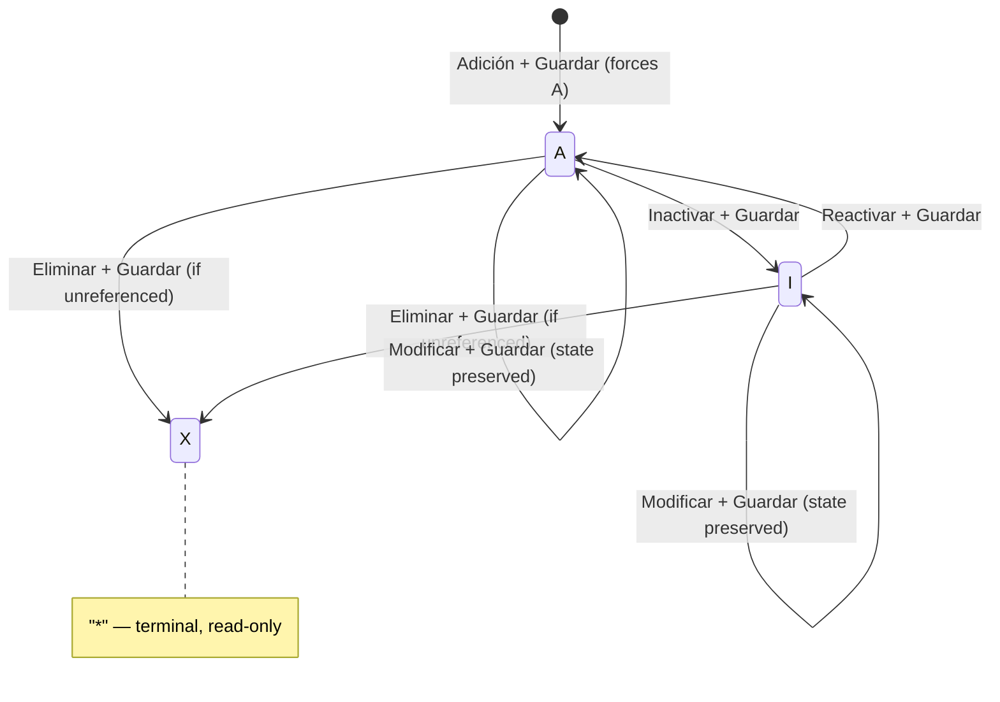

# Maestro de Personal — Logic Specification

> Module: `Maestro de Personal` (Negocios Electrónicos 2026, lab group module).
> Scope: **logic only**. No UI, layout, navigation, widget, or styling decisions.
> Designer owns all presentation; builders implement this spec, technical freedom allowed, logical behavior must match this spec.
> Stack constraint: Capacitor + Ionic UI, Supabase-hosted Postgres (network-required, no offline mode).
> Distribution (PWA + APK) is out of this spec's normative scope except where noted.

## 1. Sources & precedence

1. Lab guide §4 (maintenance functions, `A/I/*` lifecycle, default ordering, FK selection flow, optionals).
2. Module assignment: `Maestro de Personal` + `Países` + `Dependencia` + `Cargos`.
3. DB-course conventions (same instructor): everything domain-meaningful lives in tables
   (incl. `ESTREG`), short numeric codes as PKs, RESTRICT referential behavior.
4. This spec. On conflict between 1–3, this spec wins and calls it out explicitly.

## 2. Glossary

| Term              | Meaning                                                                                                                                                          |
| ----------------- | ---------------------------------------------------------------------------------------------------------------------------------------------------------------- |
| `A` / `I` / `*`   | Logical record states: Activo / Inactivo / Eliminado (soft-delete; nothing is ever physically deleted).                                                          |
| `ESTREG`          | Lookup table storing the three states; every data table FKs to it.                                                                                               |
| Maintenance       | The 9 operations on one table: Adición, Modificación, Eliminación, Inactivar, Reactivar, Buscar, Cancelar, Guardar, Salir.                                       |
| Pending operation | An uncommitted Adición / Modificación / Eliminación / Inactivar / Reactivar awaiting Guardar or Cancelar. At most one pending operation per maintenance session. |
| List query        | Read-only ordered enumeration of a table's rows (all states unless filtered).                                                                                    |
| Selection query   | Read-only enumeration of a reference table's **Activo-only** rows, alphabetical, used to bind an FK value.                                                       |

## 3. Constants (single source; referenced, never re-literal'd)

| ID                          | Value                                           | Used by             |
| --------------------------- | ----------------------------------------------- | ------------------- |
| `DNI_LEN`                   | 8 digits, `^[0-9]{8}$`                          | §5.4 validation     |
| `MIN_NAME`                  | trimmed length ≥ 2                              | §5 all `Nom` fields |
| `MAX_NAME`                  | 100 chars                                       | §5 all `Nom` fields |
| `MIN_AGE`                   | 18 years (`PerFecNac ≤ today − 18y`)            | §5.4 validation     |
| `EST_A` / `EST_I` / `EST_X` | 1 / 2 / 3 (FK ids; logical symbols `A`/`I`/`*`) | §4, §6, DDL         |

## 4. Data model (logical)

### 4.1 Tables

| Table         | Code PK               | Attributes                      | FKs                                                                                      |
| ------------- | --------------------- | ------------------------------- | ---------------------------------------------------------------------------------------- |
| `ESTREG`      | `EstRegCod` SMALLINT  | `EstRegNom`, `EstRegSim`        | — (root lookup)                                                                          |
| `PAIS`        | `PaiCod` SMALLINT > 0 | `PaiNom`                        | `PaiEstReg → ESTREG`                                                                     |
| `DEPENDENCIA` | `DepCod` SMALLINT > 0 | `DepNom`                        | `DepEstReg → ESTREG`                                                                     |
| `CARGO`       | `CarCod` SMALLINT > 0 | `CarNom`                        | `CarEstReg → ESTREG`                                                                     |
| `PERSONAL`    | `PerCod` INTEGER > 0  | `PerNom`, `PerDNI`, `PerFecNac` | `PerPaiCod → PAIS`, `PerDepCod → DEPENDENCIA`, `PerCarCod → CARGO`, `PerEstReg → ESTREG` |

Every data table additionally carries DB-managed `created_at`, `updated_at` (§10). No other columns exist.

### 4.2 `ESTREG` rows (fixed; seeded once; never modified by the app)

| `EstRegCod` | `EstRegNom` | `EstRegSim` (logical) |
| ----------- | ----------- | --------------------- |
| 1           | `Activo`    | `A`                   |
| 2           | `Inactivo`  | `I`                   |
| 3           | `Eliminado` | `*`                   |

App logic branches on `EstRegCod`; `EstRegSim` is the lab-guide symbol for display/ordering metadata.

### 4.3 Keys & identity

- R1: Codes are operator-assigned positive integers, unique per table (PK). No sequences, no auto-generation.
- R2: Codes are **immutable**: Modificación never changes a row's code.
- R3: `PAIS.PaiNom`, `DEPENDENCIA.DepNom`, `CARGO.CarNom` are unique **case-insensitively** (trailing/leading blanks ignored).
- R4: `PERSONAL.PerDNI` is unique (exact match; digits only so case is moot).
- R5: `PERSONAL.PerNom` is not unique (homonyms exist).

## 5. Field rules

### 5.1 `PAIS` / `DEPENDENCIA` / `CARGO` (identical shape)

| Field    | Type         | Required | Rules                                                                                                    |
| -------- | ------------ | -------- | -------------------------------------------------------------------------------------------------------- |
| `Cod`    | SMALLINT     | yes      | > 0; immutable after insert; error `E-DUP` on clash                                                      |
| `Nom`    | VARCHAR(100) | yes      | trimmed length `MIN_NAME..MAX_NAME`; case-insensitive unique; error `E-DUP` on clash                     |
| `EstReg` | FK → ESTREG  | yes      | Adición forces `EST_A`; transitions per §6; never NULL; never directly writable except via lifecycle ops |

### 5.2 `DEPENDENCIA` seed content (lab-mandated)

Initial rows: `Sistemas`, `Contabilidad`, `Almacen` (exact lab spellings), all `A`. See DDL seeds.

### 5.3 `PERSONAL` identity fields

| Field       | Type         | Required | Rules                                                                                  |
| ----------- | ------------ | -------- | -------------------------------------------------------------------------------------- |
| `PerCod`    | INTEGER      | yes      | > 0; immutable; `E-DUP` on clash                                                       |
| `PerNom`    | VARCHAR(100) | yes      | trimmed length `MIN_NAME..MAX_NAME`; not unique                                        |
| `PerDNI`    | CHAR(8)      | yes      | exactly `DNI_LEN` ASCII digits; unique; modifiable but stays unique (`E-DUP` on clash) |
| `PerFecNac` | DATE         | yes      | strictly past **and** age ≥ `MIN_AGE` at Guardar time (`E-RANGE` otherwise)            |

### 5.4 `PERSONAL` FK fields

| Field       | Target               | Required | Rules                                                                                               |
| ----------- | -------------------- | -------- | --------------------------------------------------------------------------------------------------- |
| `PerPaiCod` | `PAIS.PaiCod`        | yes      | must reference an existing row whose `EstReg = EST_A` **at Guardar time** (`E-REF-STATE` otherwise) |
| `PerDepCod` | `DEPENDENCIA.DepCod` | yes      | same as above                                                                                       |
| `PerCarCod` | `CARGO.CarCod`       | yes      | same as above                                                                                       |
| `PerEstReg` | FK → ESTREG          | yes      | same lifecycle rules as §5.1                                                                        |

- R6: FK values are bound exclusively via the selection flow (§9); free-typing a code is not a valid input path (there is no validation path for it — fail fast with `E-REF` if a code has no matching row).
- R7: A `PERSONAL` row keeps its stored FK codes even if the referenced row is later inactivated. Only new/edited Guardar requires Activo targets.

## 6. Record-state lifecycle



### 6.1 Transition table (normative; exhaustive — any cell not listed is an error)

| Op \ Current | `A`                             | `I`                             | `*`                             |
| ------------ | ------------------------------- | ------------------------------- | ------------------------------- |
| Modificar    | ✅ allowed, state unchanged     | ✅ allowed, state unchanged     | ❌ `E-TRANSITION`               |
| Inactivar    | ✅ → `I`                        | ❌ `E-TRANSITION` (already `I`) | ❌ `E-TRANSITION`               |
| Reactivar    | ❌ `E-TRANSITION` (already `A`) | ✅ → `A`                        | ❌ `E-TRANSITION`               |
| Eliminar     | ✅ → `*` iff §7 passes          | ✅ → `*` iff §7 passes          | ❌ `E-TRANSITION` (already `*`) |

- R8: `ESTREG` column is never written directly; only the four lifecycle ops change it, via Guardar.
- R9: Adición always persists `EST_A`, regardless of any other input (there is no input path for state on Adición).

## 7. Referential integrity

- R10: All FKs are `ON UPDATE RESTRICT ON DELETE RESTRICT` (physical deletes never occur anyway; the constraint documents intent and blocks console-level accidents).
- R11: `Eliminar` on a `PAIS` / `DEPENDENCIA` / `CARGO` row is **blocked** (`E-REF-BLOCKED`) iff ≥1 `PERSONAL` row with `EstReg ∈ {A, I}` references it. References from `*` Personal rows do not block.
- R12: `Inactivar` on a referenced row is **allowed** (existing Personal rows keep working per R7; the row just disappears from future selection queries).
- R13: `Eliminar` on a `PERSONAL` row is always allowed (subject only to §6.1 — nothing references Personal).
- R14: `Modificar` on a reference row's `Nom` does not touch referencing Personal rows (they store codes, not names).

## 8. Maintenance operations (per table; identical semantics)

Exactly one pending operation at a time. Starting a second while one is pending → `E-PENDING` (must Guardar or Cancelar first). This rule applies to Adición, Modificación, Eliminación, Inactivar, Reactivar.

### 8.1 Adición

- Pre: no pending operation.
- Effect: opens a pending insert with all fields empty except `EstReg := EST_A` (forced, non-editable).
- Post (on Guardar): validates §5 + R1/R3/R4, inserts row, clears pending. Errors: `E-REQUIRED`, `E-FORMAT`, `E-RANGE`, `E-DUP`, `E-REF`, `E-REF-STATE`.

### 8.2 Modificación

- Pre: no pending operation; a target row selected from the list query (§8.6/§11); target `EstReg ∈ {A, I}` else `E-TRANSITION`.
- Effect: opens a pending edit pre-loaded with the row's current values; code field non-editable (R2); `EstReg` non-editable (R8).
- Post (on Guardar): validates §5, updates non-code columns, preserves `EstReg`, clears pending. Same error set as Adición except code-clash is unreachable.

### 8.3 Eliminación / Inactivar / Reactivar

- Pre: no pending operation; target row selected; transition cell of §6.1 must be ✅ else `E-TRANSITION`; Eliminar additionally requires §7 (R11) else `E-REF-BLOCKED`.
- Effect: opens a pending single-field state change (no other field editable).
- Post (on Guardar): applies the transition, clears pending.

### 8.4 Guardar

- Pre: a pending operation exists; no-op (success, nothing written) if none — Guardar without pending is **not** an error.
- Effect: runs all validations + transition checks atomically (single transaction per Guardar); on success writes exactly one row (insert or update) and clears pending; on any failure writes nothing and keeps pending open with the error reported (`E-*`).
- Audit: insert sets `created_at = updated_at = now()`; update sets `updated_at = now()`, preserves `created_at` (§10).

### 8.5 Cancelar

- Pre: none (valid with or without pending).
- Effect: discards the pending operation if any; zero writes; list query state (ordering, filters) unchanged.

### 8.6 Buscar

- Pre: none. Read-only; never touches pending state.
- Effect: applies §11 filters to the list query. Empty criteria = full list. Filtered rows remain selectable as targets for §8.2–§8.3.

### 8.7 Salir

- Pre: **no pending operation** — invoking Salir with pending state returns `E-PENDING` (explicit Guardar/Cancelar required; no implicit commit or discard).
- Effect: ends the maintenance session; zero writes.

## 9. FK selection flow (generic rule G-SEL; inherited by all three Personal FKs)

Applies identically to `PerPaiCod → PAIS`, `PerDepCod → DEPENDENCIA`, `PerCarCod → CARGO`. Stated once; per-field rows below only name the target.

1. **Trigger**: the pending Personal operation (Adición or Modificación) requests a value for the FK field.
2. **Query**: `SELECT Cod, Nom FROM <target> WHERE EstReg = EST_A ORDER BY Nom ASC, Cod ASC` — Activo-only, alphabetical, code tiebreak. Deterministic; empty result is valid.
3. **Select**: exactly one row may be chosen; its `Cod` binds into the pending operation's FK field (replacing any prior value). No write occurs until Guardar.
4. **Cancel**: binds nothing; the FK field keeps its prior value (empty for Adición, current for Modificación). Returns to the same pending operation.
5. **Guarantee**: both outcomes return to the identical pending operation; selection never commits, never clears other fields, never alters list-query state of Personal.

| FK field    | Target table  | Selection ordering              |
| ----------- | ------------- | ------------------------------- |
| `PerPaiCod` | `PAIS`        | `Nom ASC, Cod ASC`, Activo-only |
| `PerDepCod` | `DEPENDENCIA` | `Nom ASC, Cod ASC`, Activo-only |
| `PerCarCod` | `CARGO`       | `Nom ASC, Cod ASC`, Activo-only |

## 10. Audit traceability

- R15: `created_at TIMESTAMPTZ NOT NULL DEFAULT now()`, `updated_at TIMESTAMPTZ NOT NULL DEFAULT now()` on all four data tables (not on `ESTREG`).
- R16: DB-owned: `created_at` set on insert and immutable thereafter (trigger restores `OLD.created_at` on update); `updated_at` refreshed by trigger on every update.
- R17: App treats both as read-only: never sends them on insert/update; must not include them in any write path. No `created_by`/`updated_by` — there is no identity source (no auth in scope).

## 11. Ordering & search

### 11.1 Default ordering (mandatory; ordering key is part of every list query)

| Table         | Default `ORDER BY` | Alternate (optional toggle, **in scope**) |
| ------------- | ------------------ | ----------------------------------------- |
| `PAIS`        | `Nom ASC, Cod ASC` | `Cod ASC`                                 |
| `DEPENDENCIA` | `Nom ASC, Cod ASC` | `Cod ASC`                                 |
| `CARGO`       | `Nom ASC, Cod ASC` | `Cod ASC`                                 |
| `PERSONAL`    | `Cod ASC`          | `Nom ASC, Cod ASC`                        |

- R18: Every list query carries an explicit `ORDER BY` (never reliance on physical order). The active ordering key is exposed alongside results (presentation decides how).
- R19: Main list queries include **all states** (`A/I/*`); state is part of each result row. Only selection queries (§9) filter to Activo.

### 11.2 Simple search (mandatory per table)

- Single input string; case-insensitive, accent-sensitive `contains` match.
- `PAIS`/`DEPENDENCIA`/`CARGO`: matches `Nom`. `PERSONAL`: matches `PerNom` **or** `PerDNI` (substring), plus exact-code match if the input parses as a positive integer.
- Keeps the active ordering (§11.1). Empty input = unfiltered list. All states searchable; state shown per row.

### 11.3 Advanced search (mandatory per table; AND-combined; all criteria optional, ignored when empty)

| Table         | Available filters                                                                                                                                                                                            |
| ------------- | ------------------------------------------------------------------------------------------------------------------------------------------------------------------------------------------------------------ |
| `PAIS`        | `Cod` exact · `Nom` contains (ci) · `EstReg` set ⊆ {A,I,*} (default all)                                                                                                                                     |
| `DEPENDENCIA` | `Cod` exact · `Nom` contains (ci) · `EstReg` set (default all)                                                                                                                                               |
| `CARGO`       | `Cod` exact · `Nom` contains (ci) · `EstReg` set (default all)                                                                                                                                               |
| `PERSONAL`    | `Cod` exact · `Nom` contains (ci) · `DNI` exact or prefix · `FecNac` range (`from ≤ x ≤ to`, either bound optional) · `PaiCod` equality · `DepCod` equality · `CarCod` equality · `EstReg` set (default all) |

- R20: Unknown/empty criteria never error — they are ignored. A filter combination matching zero rows returns an empty list (valid, not an error).
- R21: Filtered results keep the active ordering and remain valid selection targets for Modificación/Eliminación/Inactivar/Reactivar.

## 12. Error model (exhaustive; fail fast; no silent defaults)

| Code            | Meaning                                                                     | Raised by           |
| --------------- | --------------------------------------------------------------------------- | ------------------- |
| `E-PENDING`     | operation started (or Salir) while another is pending                       | §8                  |
| `E-REQUIRED`    | required field empty/blank                                                  | Guardar             |
| `E-FORMAT`      | type/format violation (non-numeric code/DNI, bad date)                      | Guardar             |
| `E-RANGE`       | range violation (code ≤ 0, name too short/long, age < 18, future birthdate) | Guardar             |
| `E-DUP`         | unique clash (code, reference `Nom` ci-unique, DNI)                         | Guardar             |
| `E-REF`         | FK code matches no row in target table                                      | Guardar             |
| `E-REF-STATE`   | FK target exists but is not Activo                                          | Guardar             |
| `E-REF-BLOCKED` | Eliminar blocked by live Personal references                                | Guardar (Eliminar)  |
| `E-TRANSITION`  | lifecycle cell forbidden for current state                                  | op start or Guardar |

- R22: Every failure reports its code + offending field; batch validations report all failures, not just the first. No fallbacks, no auto-correction (no trimming-to-valid, no case-folding writes — stored values are exactly as entered post-trim).

## 13. Integrity invariants (must hold after every Guardar; testable in SQL)

1. Every `EstReg` value exists in `ESTREG` (FK).
2. Every Personal FK triple references existing rows (FKs).
3. No duplicate codes / reference names (ci) / DNIs.
4. All Personal birthdates satisfy `MIN_AGE`.
5. No `PERSONAL` with `EstReg ∈ {A,I}` references a `PAIS`/`DEPENDENCIA`/`CARGO` row that was Eliminated **after** R11 was enforced (i.e., live references imply the target was never Eliminated while referenced — verify via transition history in review, not in SQL).
6. `created_at ≤ updated_at` on every row; `created_at` immutable.

## 14. Out of scope (explicit non-goals)

- All UI/layout/navigation/widget/styling/copy decisions (designer-owned).
- Authentication, users, roles, `created_by`/`updated_by`.
- Offline mode / local cache / sync (network-required at every data op).
- Backend API (app uses Supabase client directly), push, files, reports.
- Physical deletes, bulk import/export, audit-history tables.
- Phased builds — all four maintenances ship in one pass (avance slicing is a presentation concern, not a spec concern).

## 15. Acceptance criteria

- [ ] All four tables implement all 9 operations per §8 with §6.1 transitions enforced.
- [ ] Adición forces `A`; codes immutable; validations of §5 enforced at Guardar with §12 codes.
- [ ] Eliminar blocked per R11 with `E-REF-BLOCKED`; Inactivar allowed on referenced rows.
- [ ] Selection flow follows G-SEL exactly for all three FKs (Activo-only, alphabetical, select-binds / cancel-keeps).
- [ ] List queries carry §11.1 default ordering with toggle; search per §11.2 + §11.3.
- [ ] Audit columns DB-managed per §10; invariants §13 hold.
- [ ] DDL appendix + seeds apply cleanly to a fresh Supabase project; app runs against it over network (demo condition).

---

## Appendix A — Normative DDL (Supabase / Postgres 15+)

```sql
-- ============================================================
-- Maestro de Personal — normative schema. Apply once, in order.
-- ============================================================

-- ---- 0. State lookup (root; everything FKs here) ----
CREATE TABLE estreg (
  "EstRegCod" SMALLINT PRIMARY KEY,
  "EstRegNom" VARCHAR(10) NOT NULL UNIQUE,
  "EstRegSim" CHAR(1) NOT NULL UNIQUE
    CHECK ("EstRegSim" IN ('A','I','*'))
);

INSERT INTO estreg ("EstRegCod","EstRegNom","EstRegSim") VALUES
  (1,'Activo','A'),
  (2,'Inactivo','I'),
  (3,'Eliminado','*');

-- ---- 1. Reference tables (identical shape) ----
CREATE TABLE pais (
  "PaiCod"    SMALLINT NOT NULL PRIMARY KEY CHECK ("PaiCod" > 0),
  "PaiNom"    VARCHAR(100) NOT NULL CHECK (char_length(btrim("PaiNom")) >= 2),
  "PaiEstReg" SMALLINT NOT NULL DEFAULT 1
    REFERENCES estreg("EstRegCod") ON UPDATE RESTRICT ON DELETE RESTRICT,
  created_at TIMESTAMPTZ NOT NULL DEFAULT now(),
  updated_at TIMESTAMPTZ NOT NULL DEFAULT now()
);
CREATE UNIQUE INDEX pais_nom_ci ON pais (lower(btrim("PaiNom")));

CREATE TABLE dependencia (
  "DepCod"    SMALLINT NOT NULL PRIMARY KEY CHECK ("DepCod" > 0),
  "DepNom"    VARCHAR(100) NOT NULL CHECK (char_length(btrim("DepNom")) >= 2),
  "DepEstReg" SMALLINT NOT NULL DEFAULT 1
    REFERENCES estreg("EstRegCod") ON UPDATE RESTRICT ON DELETE RESTRICT,
  created_at TIMESTAMPTZ NOT NULL DEFAULT now(),
  updated_at TIMESTAMPTZ NOT NULL DEFAULT now()
);
CREATE UNIQUE INDEX dependencia_nom_ci ON dependencia (lower(btrim("DepNom")));

CREATE TABLE cargo (
  "CarCod"    SMALLINT NOT NULL PRIMARY KEY CHECK ("CarCod" > 0),
  "CarNom"    VARCHAR(100) NOT NULL CHECK (char_length(btrim("CarNom")) >= 2),
  "CarEstReg" SMALLINT NOT NULL DEFAULT 1
    REFERENCES estreg("EstRegCod") ON UPDATE RESTRICT ON DELETE RESTRICT,
  created_at TIMESTAMPTZ NOT NULL DEFAULT now(),
  updated_at TIMESTAMPTZ NOT NULL DEFAULT now()
);
CREATE UNIQUE INDEX cargo_nom_ci ON cargo (lower(btrim("CarNom")));

-- ---- 2. Master table ----
CREATE TABLE personal (
  "PerCod"    INTEGER NOT NULL PRIMARY KEY CHECK ("PerCod" > 0),
  "PerNom"    VARCHAR(100) NOT NULL CHECK (char_length(btrim("PerNom")) >= 2),
  "PerDNI"    CHAR(8) NOT NULL UNIQUE CHECK ("PerDNI" ~ '^[0-9]{8}$'),
  "PerFecNac" DATE NOT NULL
    CHECK ("PerFecNac" <= (current_date - INTERVAL '18 years')::date),
  "PerPaiCod" SMALLINT NOT NULL
    REFERENCES pais("PaiCod") ON UPDATE RESTRICT ON DELETE RESTRICT,
  "PerDepCod" SMALLINT NOT NULL
    REFERENCES dependencia("DepCod") ON UPDATE RESTRICT ON DELETE RESTRICT,
  "PerCarCod" SMALLINT NOT NULL
    REFERENCES cargo("CarCod") ON UPDATE RESTRICT ON DELETE RESTRICT,
  "PerEstReg" SMALLINT NOT NULL DEFAULT 1
    REFERENCES estreg("EstRegCod") ON UPDATE RESTRICT ON DELETE RESTRICT,
  created_at TIMESTAMPTZ NOT NULL DEFAULT now(),
  updated_at TIMESTAMPTZ NOT NULL DEFAULT now()
);

-- ---- 3. Audit triggers (DB-owned timestamps; created_at immutable) ----
CREATE OR REPLACE FUNCTION set_updated_at() RETURNS trigger
LANGUAGE plpgsql AS $$
BEGIN
  NEW.created_at := OLD.created_at;
  NEW.updated_at := now();
  RETURN NEW;
END $$;

CREATE TRIGGER pais_audit     BEFORE UPDATE ON pais
  FOR EACH ROW EXECUTE FUNCTION set_updated_at();
CREATE TRIGGER dependencia_audit BEFORE UPDATE ON dependencia
  FOR EACH ROW EXECUTE FUNCTION set_updated_at();
CREATE TRIGGER cargo_audit    BEFORE UPDATE ON cargo
  FOR EACH ROW EXECUTE FUNCTION set_updated_at();
CREATE TRIGGER personal_audit BEFORE UPDATE ON personal
  FOR EACH ROW EXECUTE FUNCTION set_updated_at();
-- ---- 4. Row-level security: prototype-open (no auth in scope) ----
-- NOTE: `anon` / `authenticated` are Supabase-managed roles — present in every
-- Supabase project; on vanilla Postgres create them first (verification only).
-- Permissive by design for the graded prototype. Production would scope these.
ALTER TABLE pais        ENABLE ROW LEVEL SECURITY;
ALTER TABLE dependencia ENABLE ROW LEVEL SECURITY;
ALTER TABLE cargo       ENABLE ROW LEVEL SECURITY;
ALTER TABLE personal    ENABLE ROW LEVEL SECURITY;

CREATE POLICY open_all ON pais        FOR ALL TO anon, authenticated USING (true) WITH CHECK (true);
CREATE POLICY open_all ON dependencia FOR ALL TO anon, authenticated USING (true) WITH CHECK (true);
CREATE POLICY open_all ON cargo       FOR ALL TO anon, authenticated USING (true) WITH CHECK (true);
CREATE POLICY open_all ON personal    FOR ALL TO anon, authenticated USING (true) WITH CHECK (true);
-- estreg: readable catalog, no app writes; leave RLS off (or mirror open-read if enabled).
```

## Appendix B — Normative seed data

```sql
-- Lab-mandated dependencias (exact spellings), all Activo.
INSERT INTO dependencia ("DepCod","DepNom","DepEstReg") VALUES
  (1,'Sistemas',1),
  (2,'Contabilidad',1),
  (3,'Almacen',1);

INSERT INTO pais ("PaiCod","PaiNom","PaiEstReg") VALUES
  (1,'Perú',1),
  (2,'Chile',1),
  (3,'Colombia',1),
  (4,'Ecuador',1),
  (5,'Bolivia',1);

INSERT INTO cargo ("CarCod","CarNom","CarEstReg") VALUES
  (1,'Analista de Sistemas',1),
  (2,'Programador',1),
  (3,'Contador',1),
  (4,'Almacenero',1),
  (5,'Gerente',1);

INSERT INTO personal
  ("PerCod","PerNom","PerDNI","PerFecNac","PerPaiCod","PerDepCod","PerCarCod","PerEstReg")
VALUES
  (1,'Juan Pérez','70000001','1990-03-15',1,1,2,1),
  (2,'María López','70000002','1988-07-22',1,2,3,1),
  (3,'Carlos García','70000003','1995-11-02',2,3,4,1),
  (4,'Ana Rodríguez','70000004','1985-01-30',1,1,1,1);
```

## Appendix C — Canonical queries (informative; logic reference)

```sql
-- List queries (defaults; §11.1)
SELECT * FROM pais        ORDER BY "PaiNom" ASC, "PaiCod" ASC;
SELECT * FROM dependencia ORDER BY "DepNom" ASC, "DepCod" ASC;
SELECT * FROM cargo       ORDER BY "CarNom" ASC, "CarCod" ASC;
SELECT * FROM personal    ORDER BY "PerCod" ASC;

-- Selection queries (G-SEL; §9)
SELECT "PaiCod","PaiNom" FROM pais
 WHERE "PaiEstReg"=1 ORDER BY "PaiNom" ASC, "PaiCod" ASC;
SELECT "DepCod","DepNom" FROM dependencia
 WHERE "DepEstReg"=1 ORDER BY "DepNom" ASC, "DepCod" ASC;
SELECT "CarCod","CarNom" FROM cargo
 WHERE "CarEstReg"=1 ORDER BY "CarNom" ASC, "CarCod" ASC;

-- Simple search, Personal (§11.2), :q = input
SELECT * FROM personal
 WHERE "PerNom" ILIKE '%'||:q||'%'
    OR "PerDNI" LIKE '%'||:q||'%'
    OR ("PerCod")::text = :q
 ORDER BY "PerCod" ASC;

-- Eliminar guard, e.g. PAIS :cod (R11)
SELECT EXISTS (
  SELECT 1 FROM personal
   WHERE "PerPaiCod"=:cod AND "PerEstReg" IN (1,2)
) AS blocked;
```
